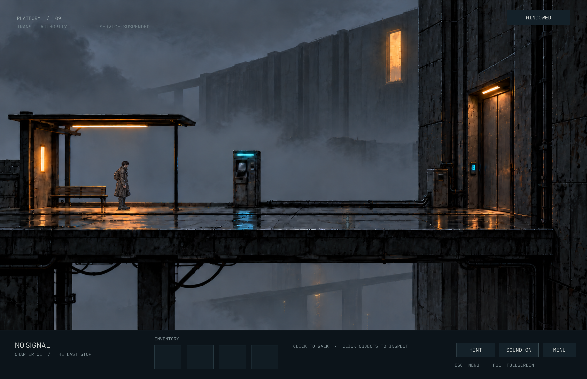

# NO SIGNAL

**A demo level of an atmospheric point-and-click adventure in a minimalist cyberpunk world.**

A solitary traveler, an abandoned transit platform, and a city that no longer answers.

This repository hosts standalone releases of **NO SIGNAL** for macOS and Windows. Version **0.3.3 — The Last Stop** includes the first playable location.

---

## 📥 Installation

Download version **0.3.3** from [GitHub Releases](https://github.com/SEVGroup/no-signal-release/releases/tag/v0.3.3).

### macOS

1. Download **AppleSilicon.zip** for a Mac with an M-series chip, or **macOS.zip** for a universal build supporting Intel and Apple Silicon.
2. Unzip the downloaded archive.
3. Drag **NO SIGNAL.app** into your **Applications** folder.
4. Launch NO SIGNAL from Applications.

### Windows

1. Download **Windows.zip** from the release page.
2. Extract the archive into a folder.
3. Launch **NO-SIGNAL.exe**.

No Godot installation is required. A SHA256 checksum file is included with the release downloads.

## 🔐 macOS Security Warning

NO SIGNAL is not yet notarized by Apple. macOS may display a security warning when you first launch the app.

**If macOS blocks NO SIGNAL:**

1. Try opening NO SIGNAL normally.
2. Open **System Settings → Privacy & Security**.
3. Scroll down to the **Security** section.
4. Find the message about NO SIGNAL and click **Open Anyway**.
5. Enter your Mac password if prompted.
6. Confirm by clicking **Open**.

**You only need to do this once.**

## 🎮 Controls

- **Left click** to walk, inspect objects, or select an inventory item.
- **Right click** to clear the selected item.
- **Esc** to close an inspection window or open the menu.
- **F11** or **Alt+Enter** to toggle fullscreen.
- **M** to toggle sound.

Progress saves automatically. Choose a language in **Settings**: English, Russian, German, or Spanish.

The filenames and in-game version label retain **TEST**, matching the approved v0.3.3 release archives. Windows builds have been exported and archive-checked; a full playthrough on Windows hardware is still pending.

---

## 💬 Feedback

Found a bug or have a suggestion?

Feel free to [open an issue](https://github.com/SEVGroup/no-signal-release/issues).

---

## 📸 Screenshots

